<div align="center">

# Gwent Reimagined

**The Witcher 3 Gwent card game as a fast, native app for macOS and iOS (Swift + Metal). Android: work in progress.**


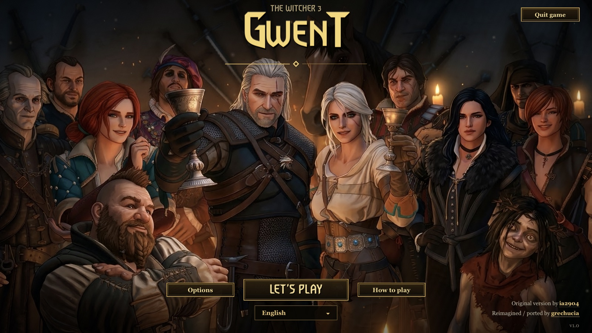

</div>

> **This is an unofficial fan work and is not approved/endorsed by CD PROJEKT RED.**
> Gwent, The Witcher, all characters and artwork are © CD PROJEKT S.A. / CD PROJEKT RED. The project is free and non-commercial. See [NOTICE.md](NOTICE.md) and the [CD PROJEKT RED Fan Content Guidelines](https://www.cdprojektred.com/en/fan-content).

## Table of contents

- [Features](#features)
- [Screenshots](#screenshots)
- [Requirements](#requirements)
- [Building](#building)
- [Controls](#controls)
- [Saves](#saves)
- [Translations](#translations)
- [Project structure](#project-structure)
- [Testing and diagnostics](#testing-and-diagnostics)
- [Credits](#credits)
- [License](#license)

## Features

- **Classic Witcher 3 Gwent rules**, extended with 15 factions and over 700 cards (based on Gwent Classic v5.0).
- **Native rendering**: a custom Metal 2D renderer with a virtual 1920×1080 canvas, CoreText text, an animated title screen and card effects.
- **Career mode**: start with weak cards, beat opponents, collect rewards and new leaders, and fight your way through to the bosses. Every career is generated anew and offers three difficulty levels and 6–10 chapters.
- **Deck builder**: premade decks, custom decks, a favourite "My deck", and leader selection.
- **Gamepad support**: any controller supported by Apple's GameController framework (Xbox, PlayStation, MFi). The focused element is highlighted, with no cursor.
- **11 languages**: English, Polish, German, French, Italian, Spanish, Portuguese, Russian, Chinese, Japanese and Korean.
- **In-app options**: music, sound, render resolution, frame limit (30/40/60/120 FPS, depending on the display), full screen, language, save location and player name.
- **Synced saves**: a single JSON save file that can live in iCloud Drive or any folder.

## Screenshots

| Game board | Late game |
|---|---|
| 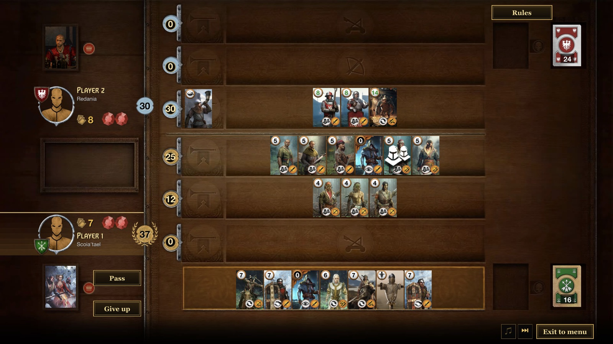 | 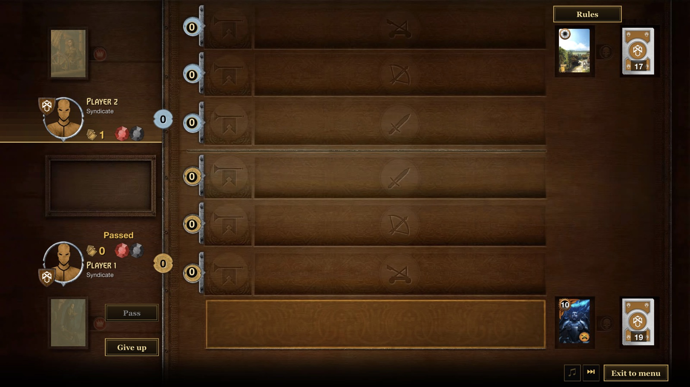 |
| **Start menu** | **Factions** |
| 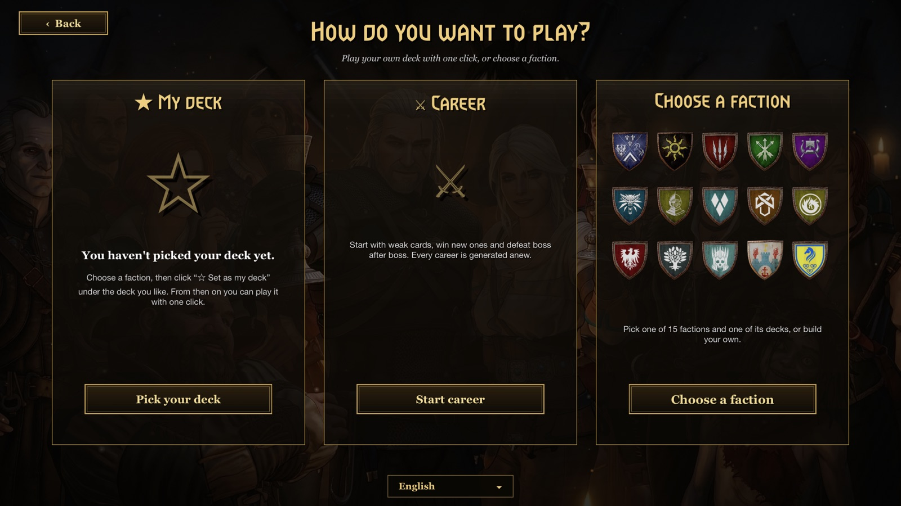 | 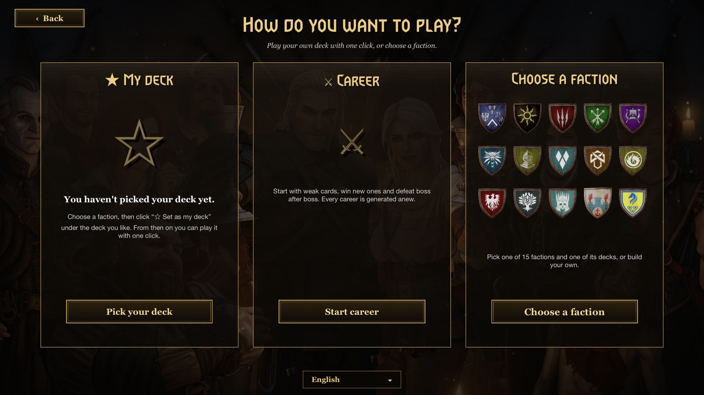 |
| **Premade decks** | **Deck preview** |
| 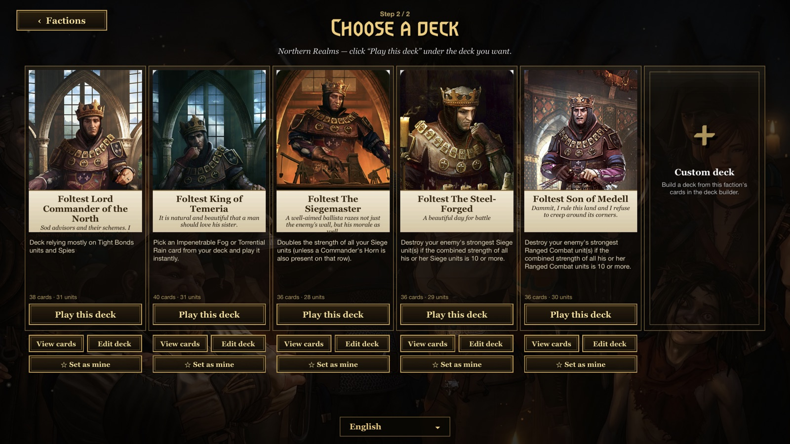 | 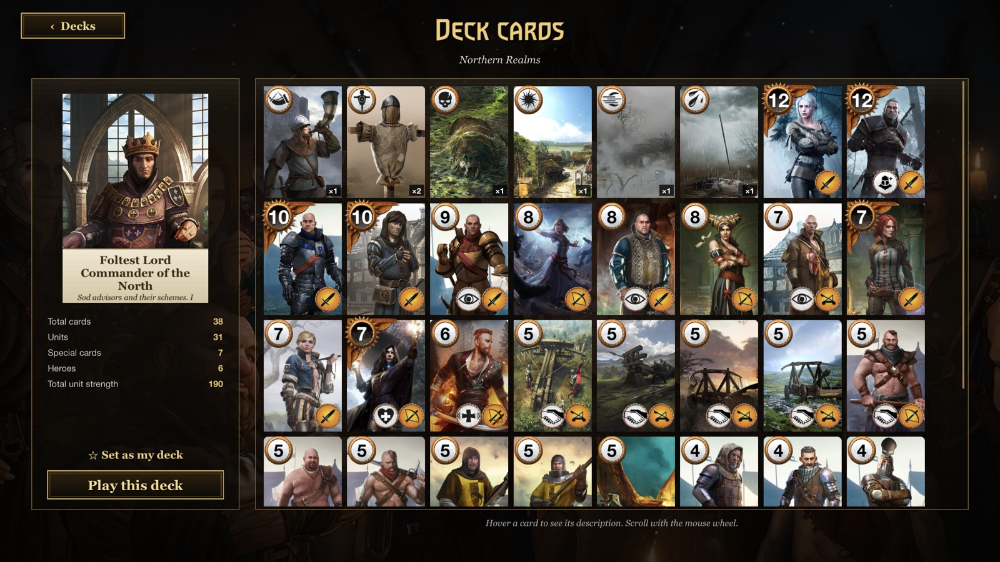 |
| **Deck builder** | **Career** |
| 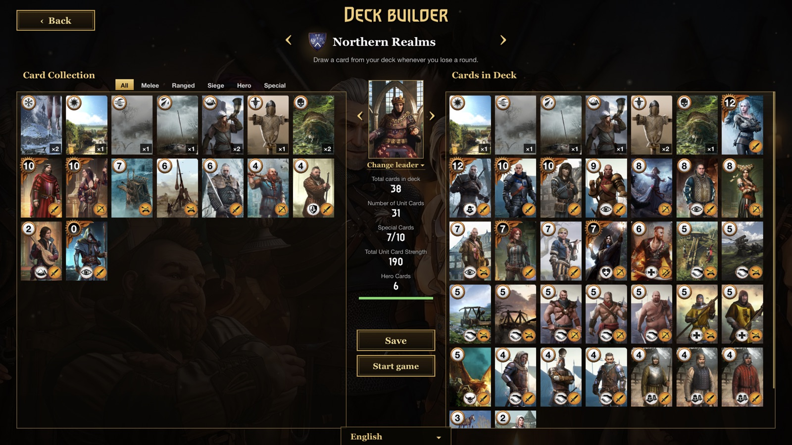 | 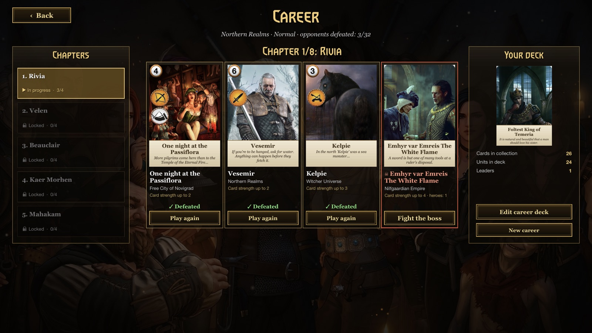 |
| **Career reward** | **Options** |
| 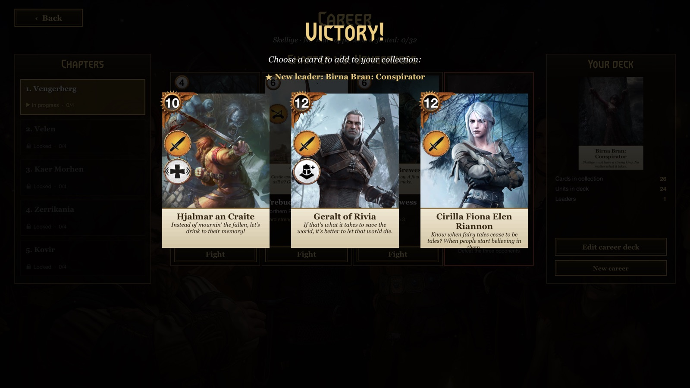 | 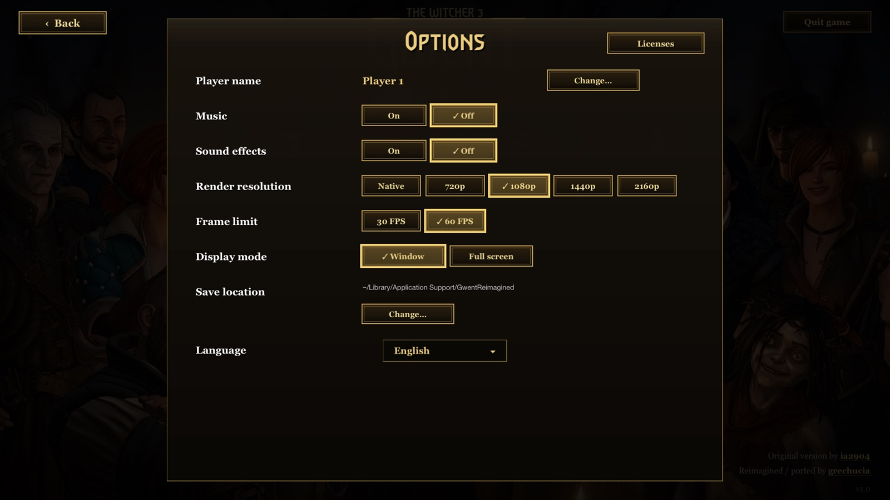 |
| **Save location** | **Rules** |
| 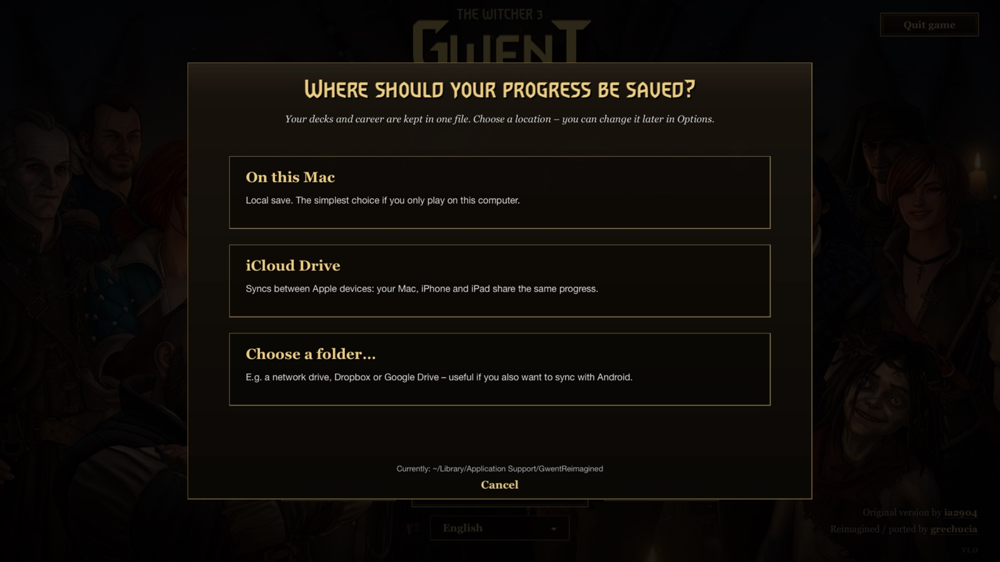 | 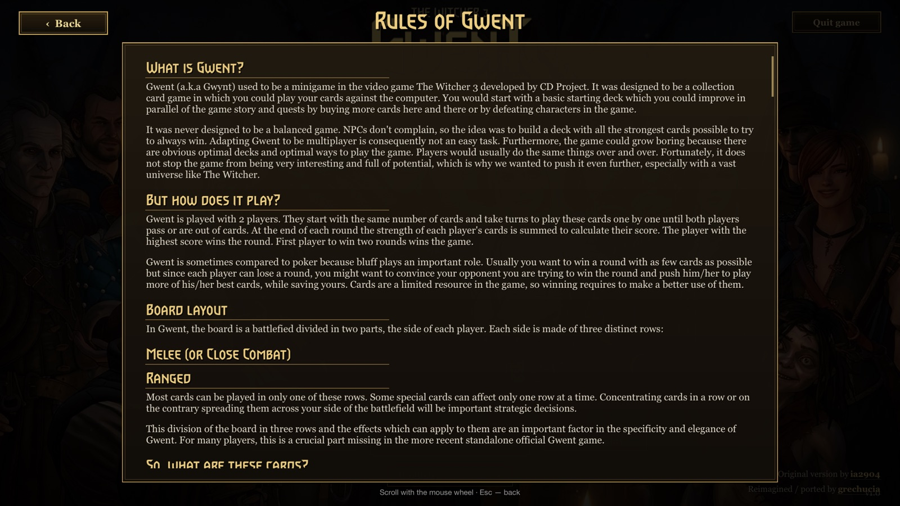 |

## Requirements

- macOS 14 Sonoma or newer on Apple Silicon (arm64)
- iOS / iPadOS 17 or newer (device or Simulator) for the iOS build; Xcode for the iOS SDK
- Xcode Command Line Tools (`xcode-select --install`)
- Python 3 (only for the translation tools)

## Building

```bash
git clone https://github.com/grechucia/gwent-reimagined.git
cd gwent-reimagined
./native/build.sh          # builds native/build/GwentReimagined.app
./native/build.sh --run    # builds and launches the app
```

The build script:

1. exports the game data (cards, decks, factions, abilities, translations) from the original JS files to JSON (`native/tools/export-data.js`);
2. compiles all Swift sources in `native/Sources` with `swiftc`, so no Xcode project is needed;
3. copies the game assets (`img`, `audio`, `sfx`, `fonts`), shrinking card images where possible;
4. generates the app icon, then bundles and ad-hoc signs the `.app`.

To install the app, copy `native/build/GwentReimagined.app` to `/Applications`.

### iOS / iPadOS

```bash
./native/build-ios.sh          # unsigned device build -> native/build/ios/GwentReimagined.ipa
./native/build-ios.sh --sim    # iOS Simulator build
```

The `.ipa` is not signed, so it has to be installed with a sideloading tool.

#### Recommended install: AltStore + LiveContainer

1. Install **AltStore** on your iPhone or iPad by following the guide at [altstore.io](https://altstore.io). This needs AltServer on a Mac or PC and your Apple ID.
2. In AltStore, install **LiveContainer** from the source at [github.com/LiveContainer/LiveContainer](https://github.com/LiveContainer/LiveContainer). Use its release `.ipa` or its AltStore source.
3. Download `GwentReimagined.ipa` from the [Releases](https://github.com/grechucia/gwent-reimagined/releases) page to your device, for example into the Files app.
4. Open **LiveContainer**, tap **+**, select `GwentReimagined.ipa` and wait for it to import.
5. Tap **Gwent** in LiveContainer, then **Run**.

LiveContainer runs the app inside an app that is already signed. This avoids the 3-app limit and the 7-day re-signing of free Apple IDs for each app.
Alternatively, install the `.ipa` directly with AltStore or Sideloadly. A free Apple ID then requires re-signing every 7 days.

On iOS, saves are stored in **Files → On My iPhone → GwentReimagined**, or in any folder you choose (for example in iCloud Drive).

### Android

Android support is **work in progress**.

## Controls

| Action | Mouse / keyboard | Gamepad |
|---|---|---|
| Move between buttons and cards | mouse | D-pad / left stick |
| Select / play the focused element | left click / tap | **A** / ✕ |
| Card details / cancel | right click (long press) / **Esc** | **X** / ▢, **B** / ○ |
| Scroll lists | scroll wheel | right stick |
| Options / pause | – | **Menu** / Options |

## Saves

The first time you press **Play**, the game asks where to keep your save:

- **This Mac**: `~/Library/Application Support/GwentReimagined/`
- **iCloud Drive**: `~/Library/Mobile Documents/com~apple~CloudDocs/GwentReimagined/`, which syncs between Apple devices
- **Custom folder**: for example a network drive, to sync with other platforms

You can change the location later in **Options**. Everything (career, custom decks, favourite deck, player name) is stored in a single file, `GwentReimagined-save.json`.

## Translations

UI strings and card texts live in `native/Resources/data/lang_<code>.json`. English (`lang_en.json`) is the source language. The pipeline lives in `native/tools/i18n`:

```bash
cd native/tools/i18n
python3 extract.py     # collect every English string -> source_en.json
python3 split.py       # split new strings into parts -> src_<n>.json (existing parts stay untouched)
```

### Adding a new language

1. For each `src_<n>.json`, create `tr_<code>_<n>.json` holding a JSON array of translations **in the same order and with the same length** as the source part. Keep placeholders, HTML tags and line breaks intact.
2. Validate the files, then assemble the language file:
   ```bash
   python3 check.py            # reports wrong counts / invalid JSON
   python3 assemble.py <code>  # writes Resources/data/lang_<code>.json
   ```
3. Register the language in `GameData.languages` (`native/Sources/GameData.swift`), using its native name.
4. Rebuild with `./native/build.sh`. The language appears in **Options** and on the title screen.

### Updating an existing language

After adding new strings to the code (`L("English text")` or `L2("Polish", "English")`), run `extract.py` and `split.py`. Translate only the newly created `src_<n>.json` part(s), then run `check.py` and `assemble.py`.

## Project structure

```
native/
├── Sources/
│   ├── main.swift           # macOS app delegate, window, frame pacing (CADisplayLink), menu bar
│   ├── MainIOS.swift        # iOS app/scene delegates, touch input
│   ├── Platform.swift       # platform layer (dialogs, links, folder picker)
│   ├── Renderer.swift       # Metal 2D renderer, textures, CoreText text, shaders
│   ├── Scene.swift          # screens, input, game board
│   ├── SceneFX.swift        # effects, rules and licenses screens
│   ├── DeckScreens.swift    # start menu, deck selection and preview, leader picker
│   ├── DeckBuilder.swift    # deck building logic
│   ├── CareerScreens.swift  # career, save location prompt, options
│   ├── Career.swift         # career generation and the SaveStore
│   ├── Engine.swift         # game rules and abilities
│   ├── AI.swift             # computer opponent
│   ├── Gamepad.swift        # game controller input
│   ├── GameData.swift       # cards, decks, factions, localisation
│   └── Audio.swift          # music and sound effects
├── Resources/               # exported data (JSON), icon
├── tools/                   # data export, icon generator, i18n pipeline
├── build.sh                 # macOS build
└── build-ios.sh             # iOS build (.ipa / Simulator)
img/ audio/ sfx/ fonts/      # game assets
cards.js decks.js factions.js abilities.js lang/   # original game data
```

## Testing and diagnostics

Environment variables useful for automated runs:

| Variable | Effect |
|---|---|
| `GWENT_AUTOTEST=1` | computer vs computer, muted, logs to `GWENT_LOG` |
| `GWENT_MUTE=1` | no sound |
| `GWENT_SAVEDIR=<dir>` | use a separate save folder (does not touch your real save) |
| `GWENT_SHOW=<screen>` | open directly on `start`, `decks`, `builder`, `career`, `options`, `saveprompt`, `rules` or `licenses` |
| `GWENT_SCREEN=builtin` | open the window on the built-in display |
| `GWENT_SHOT=1` | borderless 1280×720 window, used for the README screenshots |

Example:

```bash
GWENT_AUTOTEST=1 GWENT_SAVEDIR=/tmp/gwent-test native/build/GwentReimagined.app/Contents/MacOS/GwentReimagined
```

## Credits

- **Original game**: Gwent from *The Witcher 3: Wild Hunt* by CD PROJEKT RED.
- **Gwent Classic** (original web version): Arun Sundaram, [asundr/gwent-classic](https://github.com/asundr/gwent-classic).
- **Gwent Classic v5.0** (the fork this project is based on): Reynolds Costa, Sylver, Iván Mtz and [ia2904](https://github.com/ia2904/gwent-classic-v5.0).
- **Gwent Reimagined** (native app, career mode, gamepad, translations): [grechucia](https://github.com/grechucia/gwent-reimagined).

See [NOTICE.md](NOTICE.md) for details.

## License

The code is released under the [MIT License with the Commons Clause](LICENSE), inherited from Gwent Classic, so it **may not be sold**. All Witcher and Gwent intellectual property (names, characters, artwork, music) belongs to CD PROJEKT S.A. / CD PROJEKT RED and is used here for non-commercial fan purposes only.
